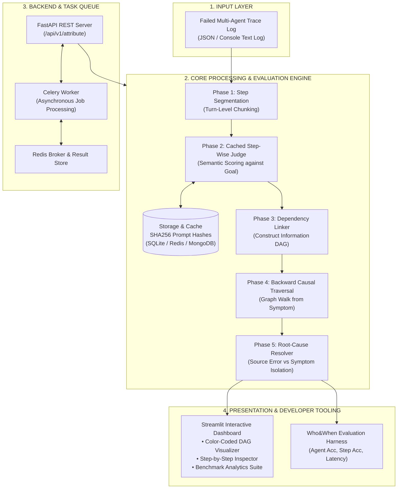
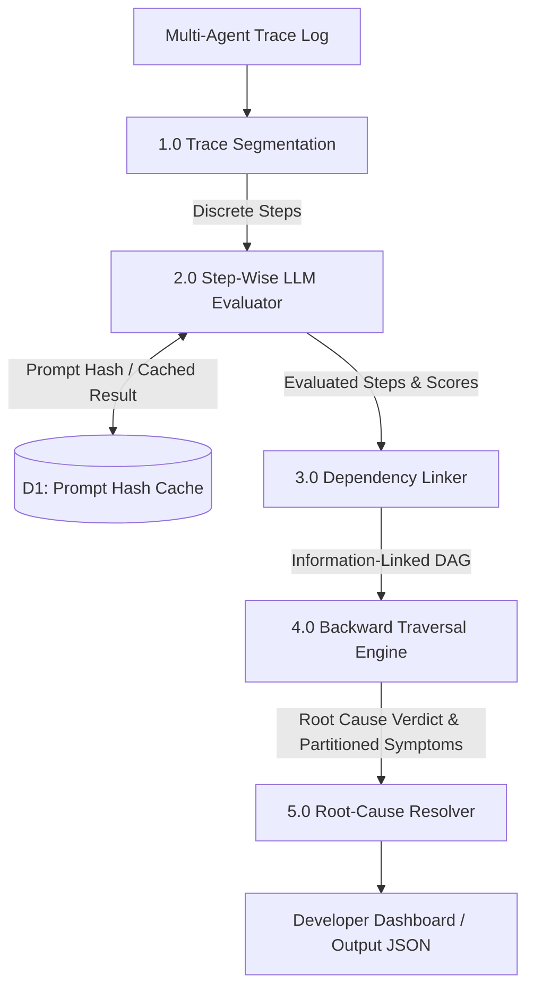
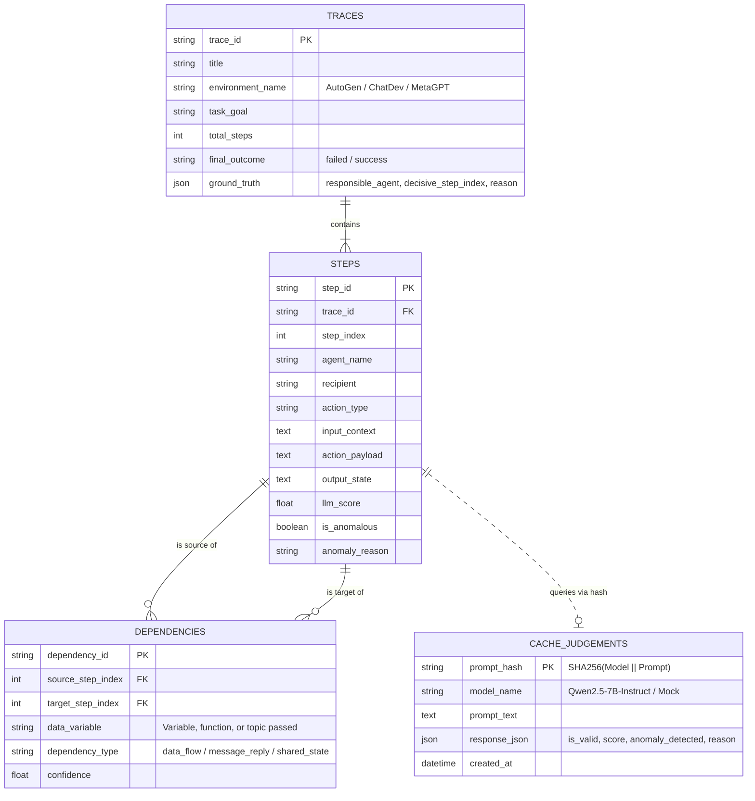

# 🏛️ 02 - System Architecture & Design

## 🏗️ 1. Architecture Overview

The system processes raw or structured multi-agent execution traces through a modular 5-phase attribution engine connected to an asynchronous backend and an interactive developer presentation layer.



---

## 📊 2. Data Flow Diagrams (DFD)

### Level-0 DFD (Context Diagram)
```mermaid
graph LR
    User["Multi-Agent Trace Log (Developer/Benchmark)"] --> |Trace JSON| System["0.0 Automated Failure Attribution System"]
    System --> |Attributed Verdict (Responsible Agent, Decisive Step, Justification, DAG)| DevDashboard["Developer Dashboard / API Client"]
```

### Level-1 DFD (Decomposition)


---

## 🔄 3. Process Logic & Step-by-Step Execution

```
[Start: Ingest Failed Trace]
       │
       ▼
[Phase 1: Trace Ingestion & Segmentation]
  - Parse turn tuples: (Agent, Recipient, Action Payload, Output State, Index)
  - Compress oversized turns (>4k tokens) preserving error messages & variable names
       │
       ▼
[Phase 2: Cached Step-Wise Evaluation]
  - For each step s_i in trace:
       ├── Generate SHA256 Prompt Hash: H = SHA256(Model || Goal || StepDetails)
       ├── Check Cache (SQLite/Redis/MongoDB)
       ├── IF cache hit: Retrieve score & anomaly verdict
       └── ELSE: Query LLM Judge, parse JSON verdict, and store in Cache
       │
       ▼
[Phase 3: Dependency-Aware Graphing (DAG)]
  - Add nodes for all steps: V = {0, 1, ..., N-1}
  - Build edges (u -> v):
       ├── Sequential conversational adjacency: (i-1) -> i
       ├── Direct agent reply: Recipient(u) == Agent(v)
       └── Shared variable/state flow: Entities produced in u consumed in v
       │
       ▼
[Phase 4 & 5: Backward Causal Traversal & Root-Cause Resolution]
  - Identify anomalous nodes: A = {i | Anomaly(i) == True or Score(i) < 0.7}
  - Find manifest failure symptom: s_fail = max(A)
  - Find causal ancestors leading to failure: Anc = Ancestors(G, s_fail) U {s_fail}
  - Isolate Root Cause:
       Earliest step r in (A ∩ Anc) such that Predecessors(r) are valid (clean)
  - Partition remaining anomalies into Propagated Symptoms: S = A \ {r}
       │
       ▼
[Output Verdict & DAG to Dashboard / API]
       │
       ▼
[End]
```

---

## 🗄️ 4. Entity-Relationship (ER) Schema



---

## 🔗 Related Notes
- [[00 - Project Overview & Index]]
- [[03 - Core Engine Implementation]]
- [[05 - API, Async Queue & Dashboard]]
