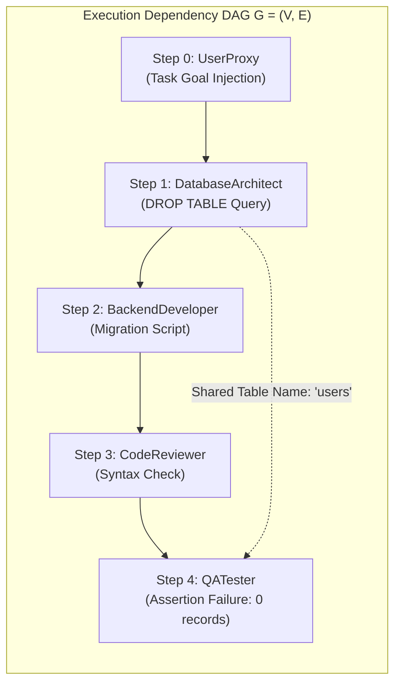
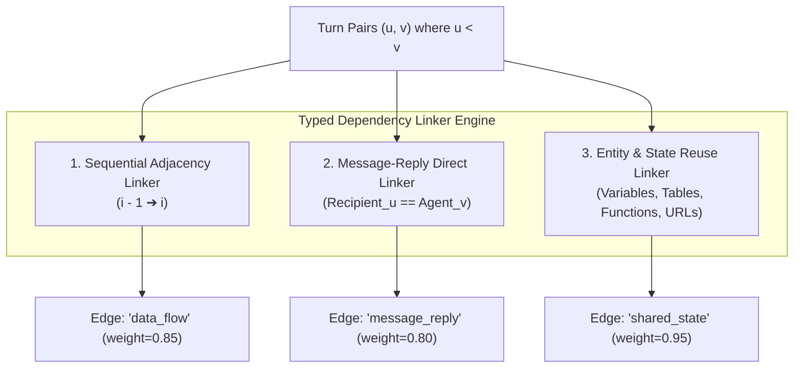
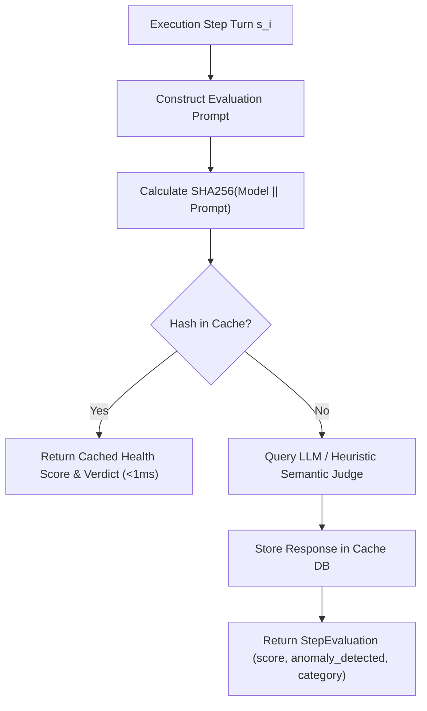
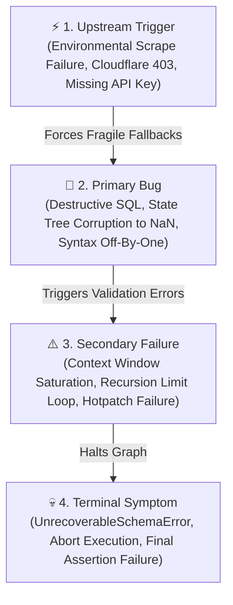
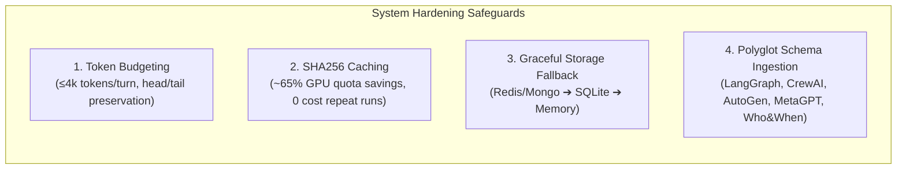

# 🧠 07 - Core Theoretical Concepts & Engine Mechanisms

This document provides an exhaustive, mathematically rigorous, and diagrammatic deep-dive into the five foundational concepts powering our **Automated Multi-Agent Failure Attribution System**.

---

## 📑 Table of Contents
1. [[#1. Graph Building & Information Modeling|1. Graph Building & Information Modeling]]
2. [[#2. Graph Traversing (Backward Causal Traversal Algorithm)|2. Graph Traversing (Backward Causal Traversal Algorithm)]]
3. [[#3. Establishing Connections & Dependency Linkage|3. Establishing Connections & Dependency Linkage]]
4. [[#4. Error Identification & Multi-Tier Blame Hierarchy|4. Error Identification & Multi-Tier Blame Hierarchy]]
5. [[#5. System Hardening & Fault Tolerance Architecture|5. System Hardening & Fault Tolerance Architecture]]

---

# 1. Graph Building & Information Modeling

## 1.1. Mathematical Formalization
A multi-agent execution history is modeled as a **Directed Acyclic Graph (DAG)**:
$$\mathcal{G} = (\mathcal{V}, \mathcal{E})$$

Where:
- **Vertices $\mathcal{V}$**: Set of discrete execution turns $\mathcal{V} = \{s_0, s_1, s_2, \dots, s_{N-1}\}$, where each turn $s_i$ is a tuple:
  $$s_i = \langle i, \text{Agent}_i, \text{Recipient}_i, \text{ActionType}_i, \text{InputContext}_i, \text{Payload}_i, \text{OutputState}_i \rangle$$
- **Directed Edges $\mathcal{E}$**: An edge $(u, v) \in \mathcal{E}$ (where $u < v$ temporally) denotes that execution step $v$ causally consumed data, context, or state emitted by step $u$.



## 1.2. Graph Data Structures in Python
We leverage `networkx.DiGraph` to represent $\mathcal{G}$. Each node maintains diagnostic metadata:
```python
G = nx.DiGraph()
G.add_node(
    s.step_index,
    step_id=s.step_id,
    agent=s.agent_name,
    action_type=s.action_type,
    score=s.evaluation.score,
    is_anomalous=s.evaluation.anomaly_detected
)
```

---

# 2. Graph Traversing (Backward Causal Traversal Algorithm)

## 2.1. The Root Cause vs. Symptom Isolation Problem
In multi-agent systems, errors cascade downstream. When step $s_k$ crashes, naive forward evaluators blame $s_k$. Our **Backward Causal Traversal** backtracks along data dependencies to find the earliest invalid node in the causal ancestor subgraph.

```mermaid
flowchart RL
    S_manifest["🔴 Manifest Symptom (Step 150: Abort / Crash)"]
    S_rec["🟠 Secondary Failure (Step 149: Context Overflow)"]
    S_bug["🔴 Primary Bug (Step 144: NaN Margin Patch)"]
    S_trig["⚡ Upstream Trigger (Step 19: 403 Scraping Block)"]
    S_clean["🟢 Upstream Valid Step (Step 1: Planning)"]

    S_manifest <-- "Walk Backward" --- S_rec
    S_rec <-- "Walk Backward" --- S_bug
    S_bug <-- "Walk Backward" --- S_trig
    S_trig <-- "Parents Valid" --- S_clean
```

## 2.2. Algorithmic Formulation

```text
Algorithm: Backward Causal Root-Cause Resolution
Input: DAG G = (V, E), Evaluated Steps with Anomaly Flags A ⊆ V
Output: Root Cause Step r, Propagated Symptoms S, Causal Chain P

1: Let A = { v ∈ V | Anomaly(v) == True or Score(v) < 0.7 }
2: If A == ∅:
3:     Return v_terminal as failure symptom
4: Let s_manifest = max(A)  // Latest visible crash/rejection point
5: Compute causal ancestors of s_manifest:
       Ancestors(s_manifest) = { u ∈ V | ∃ path u ⇝ s_manifest in G }
6: Let CausalAnomalies = (Ancestors(s_manifest) ∪ {s_manifest}) ∩ A
7: Sort CausalAnomalies in ascending temporal order: [c_1, c_2, ..., c_k]
8: For each candidate c_i in CausalAnomalies:
9:     Let InParents = { p ∈ V | (p, c_i) ∈ E }
10:    Let AnomalousParents = { p ∈ InParents | p ∈ A and p < c_i }
11:    If AnomalousParents == ∅:
12:        r = c_i  // Earliest invalid step whose parents were valid!
13:        Break
14: Let PropagatedSymptoms S = A \ {r}
15: Compute shortest path P = ShortestPath(G, source=r, target=s_manifest)
16: Return Verdict(RootCause=r, Symptoms=S, Chain=P)
```

---

# 3. Establishing Connections & Dependency Linkage

Connections (edges $(u, v)$) are established via a multi-tiered typed linker:



### Edge Types:
1. **`data_flow` (Temporal Flow)**: Added between adjacent turns $(i-1 \to i)$ ensuring standard conversational dialogue continuity.
2. **`message_reply` (Conversational Handoff)**: Added when agent $v$ directly replies to a prompt or instruction explicitly addressing agent $v$ from earlier step $u$.
3. **`shared_state` (Entity & Dataflow Re-use)**: Extracted via semantic regex and AST entity parser:
   - Variable names (e.g., `operating_margin`, `gross_margin`, `df_sales`)
   - Schema tables and database columns (e.g., `users`, `margin_percentage`)
   - Code functions and API endpoints (e.g., `run_migration()`, `calc_var()`)

---

# 4. Error Identification & Multi-Tier Blame Hierarchy

## 4.1. Semantic Step-Wise Judging
Each turn is evaluated independently against the overarching task goal and immediate input context:



## 4.2. Multi-Tier Failure Taxonomy
Our system classifies multi-agent failures into a 4-tier causal hierarchy:



---

# 5. System Hardening & Fault Tolerance Architecture

To ensure zero-cost reproducibility, context safety, and high-performance deployment:



### Key Hardening Safeguards:
1. **Turn-Level Context Budgeting**:
   - Compresses large turns exceeding 4096 tokens by retaining the first $60\%$ (instructions/inputs) and last $30\%$ (error stack traces/returns), avoiding context window degradation on traces $>32\text{k}$ tokens.
2. **Deterministic SHA256 Prompt Caching**:
   $$\text{Key} = \text{SHA256}(\text{Model} \parallel \text{"||"} \parallel \text{Prompt})$$
   Guarantees that re-running benchmark suites costs **0 additional GPU tokens**.
3. **Graceful Multi-Backend Storage Degradation**:
   - Tries connecting to MongoDB/Redis; if unavailable on standard developer laptops (8GB RAM), automatically falls back to **SQLite (`cache.db`)** or **In-Memory dict**.
4. **Polyglot Trace Ingestion**:
   - Natively normalizes custom JSON schemas (LangGraph `execution_trace`, CrewAI `status`, AutoGen `chat_history`, MetaGPT `message_pool`).

---

## 🔗 Related Notes
- [[00 - Project Overview & Index]]
- [[02 - System Architecture & Design]]
- [[03 - Core Engine Implementation]]
- [[04 - Benchmark & Evaluation Results]]
- [[06 - Review-2 Presentation & Viva Guide]]
