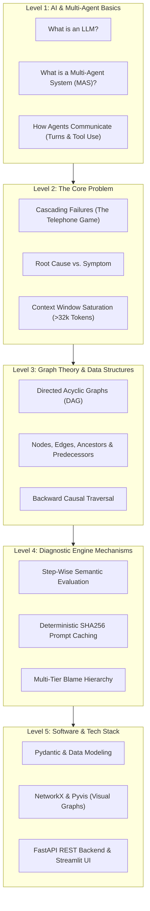

# 🔰 08 - Beginner-Friendly Prerequisite & Concept Guide

If you are new to LLMs, Multi-Agent Systems, or Graph Algorithms, this guide breaks down everything from first principles with simple analogies.

---

## 🗺️ 1. Learning Roadmap at a Glance

---

## 🤖 Level 1: Multi-Agent Systems (MAS) Fundamentals

### 1. What is an LLM Agent?
An **LLM** (Large Language Model like GPT-4 or Qwen-2.5) generates text. An **Agent** is an LLM equipped with:
- **A Persona/Role**: (e.g. *Database Architect*, *Web Scraper*, *Python Developer*, *QA Tester*).
- **Tools**: Ability to execute code, run SQL queries, search Google, or call APIs.
- **Memory**: Context of past messages.

### 2. What is a Multi-Agent System (MAS)?
Instead of asking one LLM to do everything, you create a team of specialized agents that talk to each other:
- *UserProxy* gives the goal $\to$ *Planner* breaks it into steps $\to$ *Coder* writes Python code $\to$ *Reviewer* checks syntax $\to$ *Tester* runs the code.
- Popular frameworks: **AutoGen**, **CrewAI**, **LangGraph**, **MetaGPT**.

---

## 💥 Level 2: The Failure Attribution Problem

### 1. Cascading Errors (The "Telephone Game")
In a team of 5 agents, if Agent #1 (Architect) makes a subtle mistake (e.g., writes `DROP TABLE users` instead of `ALTER TABLE`), Agent #2 writes the migration script, Agent #3 formats it, and Agent #4 (QA Tester) runs it and crashes.
- **The Crash happened at Agent #4.**
- **The True Bug was introduced at Agent #1.**

### 2. Root Cause vs. Symptom
- 🌡️ **Symptom**: The visible crash (e.g., QA Tester throws `AssertionError: 0 rows found` or Orchestrator hits `RecursionLimitExceeded`).
- 🦠 **Root Cause**: The earliest upstream mistake that produced the corrupted state (e.g., Architect writing `DROP TABLE`).

### 3. Long Context Degradation
When conversations span 50 to 150 turns (over 32,000 tokens), dumping the entire history into a single prompt confuses standard LLM judges ("lost-in-the-middle" problem).

---

## 🕸️ Level 3: Graph Theory & Data Structures

### 1. What is a DAG (Directed Acyclic Graph)?
- **Graph**: A collection of **Nodes** (circles) connected by **Edges** (lines).
- **Directed**: Edges have arrows pointing from source to destination ($u \to v$).
- **Acyclic**: No circular loops. Because time only moves forward, Step 5 cannot point backward in time to Step 2.
- **In our project**:
  - **Node**: A single execution turn (e.g., `Step 2: DatabaseArchitect`).
  - **Edge**: Data flow (e.g., Step 2 passed table name `users` to Step 3).

### 2. Ancestors vs. Predecessors
- **Predecessors**: Immediate parent steps that fed data directly into step $v$.
- **Ancestors**: All historical steps leading up to step $v$ (parents, grandparents, etc.).

### 3. Backward Causal Traversal
Instead of reading from Step 0 forward, we start at the **Crash Node** (Step 150) and walk **backwards along the DAG arrows**. We inspect each predecessor until we find the **first step that was invalid whose own parents were clean**. That step is the **Root Cause**.

---

## ⚡ Level 4: Diagnostic Mechanisms

### 1. Step-Wise Judging (Chunking)
Instead of judging the whole 100-page log at once, we evaluate each turn in isolation:
- *Does this turn follow the task goal?*
- *Did this agent introduce an error, or did it just receive bad data?*

### 2. SHA256 Prompt Hashing (Zero-Cost Caching)
- `SHA256` converts any text prompt into a fixed 64-character fingerprint (e.g. `e3b0c44298fc...`).
- When we evaluate a prompt once, we save the answer in our SQLite/Redis cache database.
- If we run the benchmark again, we fetch the saved answer in **0.001 seconds for $0.00 cost**!

### 3. Multi-Tier Blame Hierarchy
Complex failures have multiple actors:
1. **Upstream Trigger**: Environmental block (e.g., Cloudflare 403 bot block).
2. **Primary Bug**: Code/state corruption (e.g., Resetting `operating_margin` to `NaN`).
3. **Secondary Failure**: Recovery breakdown (e.g., Context window buffer overflow +412 tokens).
4. **Terminal Symptom**: Final force-termination (`UnrecoverableSchemaError`).

---

## 💻 Level 5: Software Architecture & Tech Stack

| Technology | What it does in our project |
| :--- | :--- |
| **Python 3.11** | Core programming language. |
| **Pydantic v2** | Enforces strict schemas and data models for Traces, Steps, and Verdicts. |
| **NetworkX** | Python library that builds and traverses Directed Acyclic Graphs. |
| **Pyvis & HTML** | Renders interactive, zoomable, draggable network graphs in the browser. |
| **SQLite / Redis / Mongo** | Stores SHA256 prompt caches and benchmark logs. |
| **FastAPI** | REST API backend for programmatic trace diagnosis. |
| **Streamlit** | Interactive developer dashboard UI. |

---

## 🔗 Related Notes
- [[00 - Project Overview & Index]]
- [[01 - Problem Statement & Literature Survey]]
- [[02 - System Architecture & Design]]
- [[07 - Theoretical Concepts & Core Mechanisms]]
