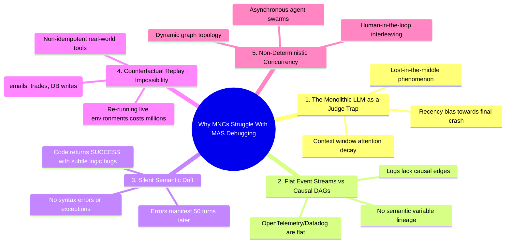

# 🏢 10 - Why Enterprise MNCs & Big Tech Struggle with Multi-Agent Failure Attribution

A critical question in AI systems engineering is: **If deterministic graph modeling and backward traversal can solve failure attribution effectively, why do major tech companies (Microsoft, OpenAI, Google, Meta, Salesforce) still struggle with debugging multi-agent systems in production?**

This note breaks down the structural, economic, and theoretical reasons behind the industry-wide multi-agent observability gap.

---

## 🛑 1. The Five Fundamental Industry Bottlenecks

---

## 🔬 2. Deep Dive into the Gaps

### 1. The "LLM-as-a-Judge" Bias (The Hammer & Nail Fallacy)
Big Tech companies specialize in building foundation models. When a multi-agent system breaks, their default engineering reflex is: *"Let's feed the entire 100-page execution log into GPT-4o / Claude-3.5 / Gemini-1.5 and ask it to find the bug."*
- **Why it collapses:**
  - **Recency Bias**: LLM attention naturally concentrates on the final $10\%$ of tokens. If Step 150 throws `RecursionLimitExceeded` or `AssertionError`, the model blames Step 150.
  - **Attention Dilution ("Lost-in-the-Middle")**: Even in 1M+ token windows, subtle bugs (e.g. `verify_signature: False` or `offset = page * limit`) buried on line 4,000 get washed out.

### 2. Flat Log Streams vs. Causal Graphs
Enterprise observability tools (Datadog, Splunk, LangSmith, Arize Phoenix) record executions as **flat, chronological timestamped spans**.
- Flat logs show **WHEN** events happened, but **NOT HOW** data flowed.
- Without constructing an **Information-Dependency DAG** and tracking variable reuse, isolating the origin in a flat log is mathematically equivalent to searching for a needle in a haystack.

### 3. The Counterfactual Re-Execution Barrier
Research proposals (like *AgenTracer* or *CHIEF*) try to diagnose failures by "re-running" turns with slight perturbations to test what-if scenarios.
- **Economic Barrier**: Re-running a 100-step trace with 4 foundation models costs \$2–\$10 per run. At enterprise scale (millions of traces/day), this requires millions of dollars in compute.
- **Side-Effect Barrier**: You **cannot re-run** an agent that already charged a customer's credit card, sent an email, or modified a production database.

### 4. Silent Semantic Drift (Zero-Exception Failures)
In real-world enterprise tasks, agents often fail without throwing any Python exception or syntax error:
- An analyst agent slightly tweaks an inflation assumption from $2.1\%$ to $2.8\%$.
- Every downstream step runs with `status: SUCCESS`.
- 60 steps later, the executive summary recommends a completely incorrect acquisition price.
- Because there is no `Traceback` or `Exception`, naive rule-based checkers see 100% normal steps.

---

## 💡 3. Why Our Hybrid Approach Breaks Through

Our project demonstrates that the solution is **not a bigger monolithic LLM**, but a **hybrid neuro-symbolic architecture**:

| Dimension | Standard Enterprise Approach | Our Implemented Architecture |
| :--- | :--- | :--- |
| **Search Space** | Flat 150-turn text dump | **Graph-structured DAG** ($\mathcal{G} = (\mathcal{V}, \mathcal{E})$) |
| **Reasoning Engine** | Single LLM prompt over whole trace | **Symbolic Backward Traversal** (NetworkX) + **Bounded Semantic Judges** ($\le 4\text{k}$ tokens) |
| **Attention Focus** | Biased towards final crash symptom | Traverses backwards to earliest uncorrupted ancestor |
| **Cost & Latency** | Expensive re-runs / monolithic tokens | **Deterministic SHA256 Caching** ($<3$ ms, 0 redundant tokens) |

---

## 🔗 Related Notes
- [[00 - Project Overview & Index]]
- [[01 - Problem Statement & Literature Survey]]
- [[02 - System Architecture & Design]]
- [[07 - Theoretical Concepts & Core Mechanisms]]
- [[08 - Beginner Friendly Prerequisite & Concepts Guide]]
