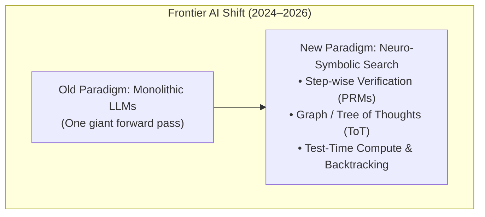
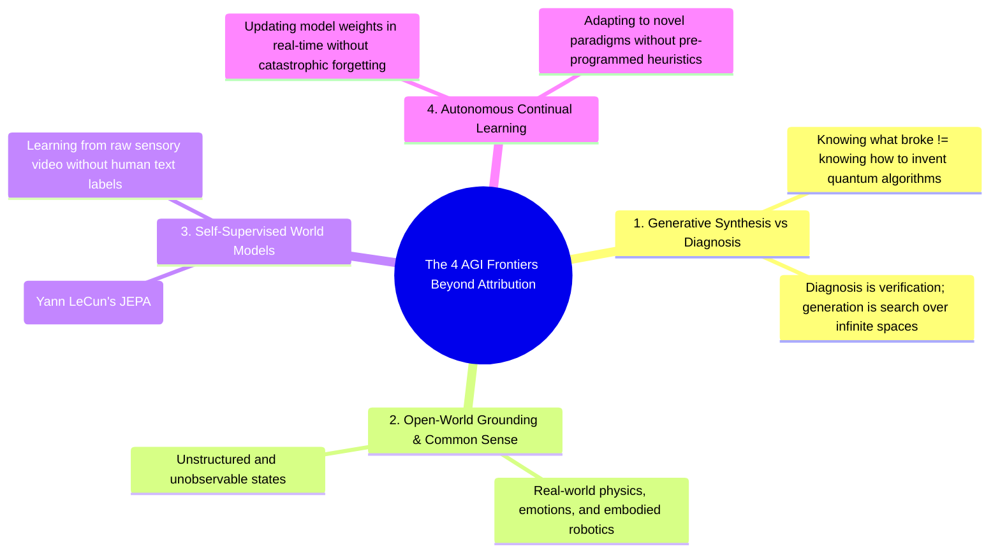

# 🌌 11 - Post-Hoc Attribution vs. AGI & Neuro-Symbolic AI

A fundamental inquiry into the boundary between **Failure Attribution** (what our system does) and **Artificial General Intelligence (AGI)** (what Google DeepMind, OpenAI, and Anthropic are building).

---

## 🧭 1. The Core Conceptual Distinction

```
+-----------------------------------------------------------------------------------------------+
| POST-HOC DIAGNOSTIC OBSERVABILITY                  IN-SITU AUTONOMOUS AGI REASONING          |
| (Our Tool / System 2 Post-Mortem)                  (Google DeepMind / OpenAI Frontiers)      |
|                                                                                               |
| • Operates AFTER a multi-agent run fails           • Operates DURING real-time generation     |
| • Reconstructs causal history from static logs     • Generates novel solutions & plans       |
| • Isolates where a mistake occurred                • Discovers new science, math & physics   |
| • Diagnostic & Observational                       • Generative & Self-Correcting In-Situ    |
+-----------------------------------------------------------------------------------------------+
```

---

## 🔬 2. Why Big Tech IS Actually Moving Toward Our Principles

Interestingly, Google DeepMind and OpenAI **are** shifting toward the exact concepts we implemented in this project:



1. **Step-Wise Verification vs. Outcome Grading (Process Reward Models - PRMs)**:
   - In OpenAI o1/o3 and DeepMind's AlphaProof, models are rewarded and judged **step-by-step** rather than only on the final answer. This is the generative equivalent of our **Step-Wise Cached Judge**.
2. **Graph / Tree Search at Test-Time (MCTS & Tree of Thoughts)**:
   - AlphaZero and modern reasoning models build **decision trees / DAGs** of intermediate reasoning steps and prune invalid branches using **backward value propagation**.
3. **Causal Credit Assignment**:
   - Frontier labs use causal inference principles to assign reward/penalty to earlier reasoning tokens that led to a downstream mathematical error.

---

## 🧱 3. Why This Approach Alone Does Not Equal "AGI"

While graph-based causal attribution solves the **debugging and observability** bottleneck, achieving true Artificial General Intelligence requires solving far deeper challenges:



### 1. Verification is Computationally Easier Than Generation ($\text{NP} \text{ vs. } \text{P}$)
- In computer science, checking whether a mathematical proof is valid (Verification / Attribution) is much simpler than *discovering* the proof from scratch (Synthesis / AGI).
- Our tool excels at **localizing known failure modes in a recorded log**. AGI requires **inventing novel strategies in uncharted environments**.

### 2. The Open-World Grounding Problem
- Our graph algorithm operates over discrete, observable turns (API calls, SQL strings, JSON keys).
- The real physical world contains **unobservable confounding variables**, human emotions, imperfect sensor data, and open-ended physics that cannot be captured in a discrete clean DAG.

### 3. Continuous Active Learning & Catastrophic Forgetting
- A true AGI must not only diagnose that `DatabaseArchitect` made an error; it must **permanently update its neural weights** in real-time so that it never makes that category of conceptual mistake again across any future domain, without forgetting prior skills.

---

## 🚀 4. How Our Project Fits into the Future of AGI

Our project represents a critical pillar of **System-2 Meta-Reasoning & AI Observability**:
- Autonomous multi-agent swarms cannot be trusted in mission-critical industries (healthcare, defense, finance) without **deterministic, explainable failure attribution**.
- By providing a fast, zero-cost, DAG-guided diagnostic engine, we provide the **feedback loop** that future self-improving AGI systems need to inspect their own trajectories and recover from mistakes.

---

## 🔗 Related Notes
- [[00 - Project Overview & Index]]
- [[01 - Problem Statement & Literature Survey]]
- [[07 - Theoretical Concepts & Core Mechanisms]]
- [[10 - Why Enterprise MNCs Fail at Multi-Agent Debugging]]
