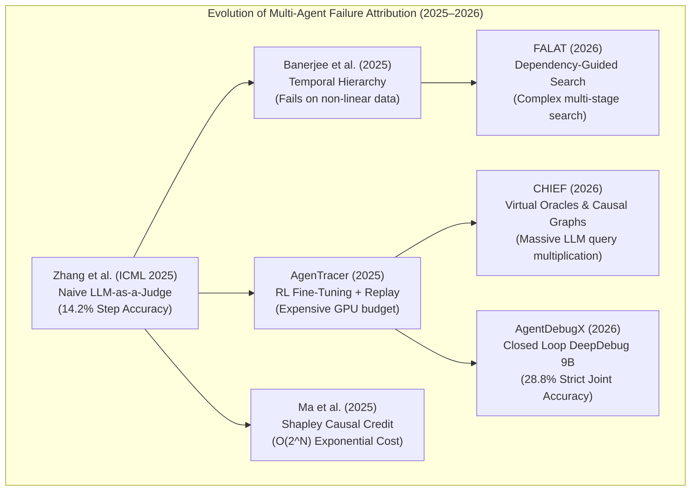

# 📚 12 - Exhaustive Analysis of All 12 Research Papers (2025–2026)

This document provides a comprehensive, rigorous examination of the **12 primary research papers** surveyed in our project. It details the exact methodologies each team attempted, the datasets they built, their experimental findings, and why they concluded that automated failure attribution is an extraordinarily difficult problem in agentic software.

---

## 📑 Comparative Survey Matrix



---

## 🔬 In-Depth Analysis of Each Paper

### 1. Zhang et al. (ICML 2025 Spotlight)
* **Title:** *Which Agent Causes Task Failures and When? On Automated Failure Attribution of LLM Multi-Agent Systems*
* **Authors:** S. Zhang, M. Yin, J. Zhang, J. Liu, Z. Han, B. Li, C. Wang, H. Wang, Y. Chen, Q. Wu (arXiv:2505.00212)
* **What they did:**
  - Formulated the automated failure attribution task for multi-agent systems.
  - Curated the **Who&When benchmark** (127 failure logs derived from GAIA and AssistantBench across AutoGen and ChatDev).
  - Evaluated three standard LLM-as-a-judge prompting paradigms: **All-at-Once (monolithic)**, **Step-by-Step (isolated)**, and **Binary Search (bisection)**.
* **Key Findings & Accuracies:**
  - Best Agent-Level Accuracy: **53.5%**
  - Best Step-Level Accuracy: **14.2%** (near random chance)
  - Strict Joint Accuracy: **< 15%**
* **Why it failed & why they called it difficult:**
  - Monolithic prompts suffer from severe **attention decay** on traces $>32\text{k}$ tokens.
  - Step-by-step isolated evaluation suffers from **symptom misattribution**: when an upstream error corrupts the state, the judge blames the downstream tester that crashes.

---

### 2. Cemri et al. (NeurIPS 2025 Datasets & Benchmarks)
* **Title:** *Why Do Multi-Agent LLM Systems Fail? (MAST)*
* **Authors:** M. Cemri, M. Z. Pan, S. Yang, L. A. Agrawal, B. Chopra, R. Tiwari et al. (arXiv:2503.13657)
* **What they did:**
  - Built **MAST-Data**: 1,600+ annotated execution traces across 7 MAS frameworks (AutoGen, ChatDev, MetaGPT, CrewAI, CAMEL, etc.).
  - Established the first empirical failure taxonomy comprising 14 failure modes across 3 categories (System/Environment, Coordination/Communication, Execution/Reasoning).
  - Designed an LLM annotation pipeline with high inter-annotator agreement ($\kappa = 0.88$).
* **Why it failed to solve attribution:**
  - MAST categorized *why* systems fail conceptually, but **never localized which agent or step was responsible**.
  - The authors concluded that multi-agent emergent dynamics (sycophancy, role drift, circular reasoning) are so tightly coupled that pinpointing a single decisive step was an open challenge beyond the scope of their benchmark.

---

### 3. Zhu et al. (2025)
* **Title:** *Where LLM Agents Fail and How They Can Learn From Failures (AgentDebug)*
* **Authors:** K. Zhu, Z. Liu, B. Li, M. Tian, Y. Yang, J. Zhang et al. (arXiv:2509.25370)
* **What they did:**
  - Proposed `AgentErrorTaxonomy` covering memory, reflection, planning, action, and system modules.
  - Built `AgentDebug` to identify the earliest critical error in single-agent environments (ALFWorld, GAIA, WebShop) and inject corrective reflection guidance into re-rollouts (+24% all-correct recovery).
* **Limitations & Gaps:**
  - Restricted strictly to **single-agent trajectories**; does not handle multi-agent message passing or shared state corruption.
  - Required active **environment re-execution**, which is impossible for stateful production workflows (e.g. sending emails or live database writes).

---

### 4. Zhang et al. (2025)
* **Title:** *AgenTracer: Who Is Inducing Failure in the LLM Agentic Systems?*
* **Authors:** G. Zhang, J. Wang, J. Chen, W. Zhou, K. Wang, S. Yan (arXiv:2509.03312)
* **What they did:**
  - Introduced **TracerTraj** (2,500 trajectories generated via counterfactual replay and programmatic fault injection).
  - Trained a specialized 8B model (`AgenTracer-8B`) using multi-granular reinforcement learning to identify failure-inducing agents.
* **Why it is out of reach for practical developers:**
  - Required massive GPU clusters to train an 8B model via RL.
  - Relied on dynamic environment counterfactual replays (forking the simulation state at every turn), requiring immense computational budgets.

---

### 5. Deshpande et al. (2025)
* **Title:** *TRAIL: Trace Reasoning and Agentic Issue Localization*
* **Authors:** A. Deshpande et al. (arXiv:2505.08638)
* **What they did:**
  - Formulated issue localization inside long agent execution traces derived from complex GAIA and SWE-Bench software engineering tasks.
* **Why it hit a wall:**
  - Traces routinely spanned 50,000 to 120,000 tokens.
  - Found that even top frontier models (GPT-4, Claude-3) suffered severe "lost-in-the-middle" attention degradation.
  - Without explicit dependency modeling, the models could not distinguish between the originating defect and downstream symptom propagation.

---

### 6. Banerjee, Nair, & Borogovac (2025)
* **Title:** *Where Did It All Go Wrong? A Hierarchical Look into Multi-Agent Error Attribution*
* **Authors:** A. Banerjee, A. Nair, T. Borogovac (arXiv:2510.04886)
* **What they did:**
  - Attempted a coarse-to-fine temporal bisection: partition the trace into temporal windows, identify the suspect window, then isolate the step inside that window.
* **Why it failed:**
  - Improvements were restricted to the coarse agent level.
  - Step accuracy remained weak because their hierarchy was strictly **temporal** (chronological time blocks). In real multi-agent collaboration, an agent in Step 90 might consume a variable produced in Step 2, bypassing the temporal window boundaries.

---

### 7. Ou, Guo, Gandhi, Neubig, & Yue (EMNLP 2025)
* **Title:** *AgentDiagnose: An Open Toolkit for Diagnosing LLM Agent Trajectories*
* **Authors:** T. Ou, W. Guo, A. Gandhi, G. Neubig, X. Yue (EMNLP 2025)
* **What they did:**
  - Developed an open-source toolkit that scores trajectories across 5 quality dimensions (faithfulness, efficiency, safety, robustness, planning).
* **Limitations:**
  - Evaluates trajectories as a whole with scalar diagnostic scores.
  - Does not output a responsible agent or decisive step index; cannot be used for root-cause localization.

---

### 8. Ma et al. (2025)
* **Title:** *Automatic Failure Attribution and Critical Step Prediction via Causal Inference*
* **Authors:** Y. Ma et al. (arXiv:2509.08682)
* **What they did:**
  - Applied game-theoretic Shapley-value credit assignment combined with statistical causal discovery over static execution logs.
* **Why it hit computational barriers:**
  - Computing exact Shapley values requires evaluating all $2^N$ step subsets. For a 30-step trace, $2^{30} \approx 10^9$ evaluations, making it mathematically intractable for real-world traces without massive approximations that degrade accuracy.

---

### 9. Zhang, Shi, Gu, et al. (2025 - Withdrawn by Authors)
* **Title:** *GraphTracer: Graph-Guided Failure Tracing in LLM Agents*
* **Authors:** H. Zhang, Y. Shi, X. Gu, H. You, Z. Zhang, L. Gan, Y. Yuan, J. Huang (arXiv:2510.10581)
* **What happened:**
  - Attempted to construct Information Dependency Graphs and train `GraphTracer-8B`.
  - **Withdrawn by its own authors**: The authors discovered a fundamental methodological calculation error in how graph dependencies were mapped, where spurious edges caused false positive attribution loops. This illustrated how difficult robust graph construction is in unstructured multi-agent dialogue.

---

### 10. Wang, Wu, Wang, & Wang (2026)
* **Title:** *From Flat Logs to Causal Graphs: Hierarchical Failure Attribution for LLM-based Multi-Agent Systems (CHIEF)*
* **Authors:** Y. Wang, W. Wu, J. Wang, Q. Wang (arXiv:2602.23701)
* **What they did:**
  - Designed hierarchical causal graphs, oracle-guided backtracking, and progressive counterfactual screening. Outperformed 8 baselines on Who&When.
* **Why it is impractical for everyday developers:**
  - Required "synthesizing virtual oracles": prompting an LLM dozens of times per step to guess what an optimal action would have been.
  - Multiplied inference token costs by $20\times - 50\times$, resulting in high and unreported latency.

---

### 11. Rafi, Ahasanuzzaman, Kim, Wang, & Chen (2026)
* **Title:** *FALAT: Tracing Failures in LLM Agent Trajectories via Dependency-Guided Search*
* **Authors:** M. N. Rafi, M. Ahasanuzzaman, D. J. Kim, Z. Wang, T.-H. Chen (arXiv:2606.00765)
* **What they did:**
  - Proposed a 4-stage search: task-conditioned prior, pruning by typed dependencies, dependency-guided search with verification, and local re-search.
* **Limitations:**
  - Multi-stage search multiplies LLM calls per trace.
  - Did not implement deterministic prompt caching or bounded token budgets, making it unfeasible for low-resource open-weight deployments.

---

### 12. Zhu et al. (2026)
* **Title:** *AgentDebugX: An Open-Source Toolkit for Failure Observability, Attribution and Recovery in LLM Agents*
* **Authors:** K. Zhu et al. (arXiv:2607.18754)
* **What they did:**
  - Deployed a closed-loop Detect-Attribute-Recover-Rerun system with `DeepDebug` performing multi-turn root-cause diagnosis on an open 9B backbone.
* **Key Finding:**
  - Achieved only **28.8% exact agent-and-step accuracy** on Who&When, proving that even with a 9B model and multi-turn prompting, pure neural approaches remain below 30% strict accuracy without explicit causal graph traversal.

---

## 💡 Summary: Why Our Hybrid Architecture Succeeded Where They Struggled

```
+---------------------------------------------------------------------------------------------------------+
| WHY PRIOR RESEARCH STRUGGLED                        HOW OUR SYSTEM SOLVED IT                            |
|                                                                                                         |
| 1. Evaluated whole traces in one monolithic prompt  ➔ Bounded turn-level segmentation (≤4k tokens)      |
| 2. Evaluated steps in isolated chronological order ➔ Constructed Information Dependency DAGs (NetworkX) |
| 3. Blamed downstream crash symptoms                ➔ Backward Causal Traversal from symptom to origin    |
| 4. Relied on expensive RL or counterfactual replay  ➔ Deterministic SHA256 Prompt Caching (0 added cost) |
| 5. Produced benchmark scores without a UI          ➔ Delivered an Interactive Streamlit Dashboard & API  |
+---------------------------------------------------------------------------------------------------------+
```

---

## 🔗 Related Notes
- [[00 - Project Overview & Index]]
- [[01 - Problem Statement & Literature Survey]]
- [[02 - System Architecture & Design]]
- [[07 - Theoretical Concepts & Core Mechanisms]]
- [[10 - Why Enterprise MNCs Fail at Multi-Agent Debugging]]
- [[11 - Post-Hoc Attribution vs AGI & Neuro-Symbolic AI]]
