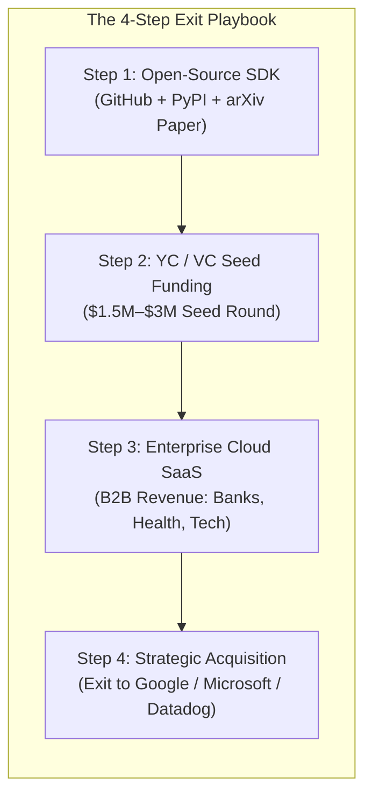

# 🚀 16 - Commercialization Blueprint & Enterprise Exit Strategy

A strategic, venture-capital-aligned roadmap for turning this **Multi-Agent Failure Attribution Engine** into a high-valuation startup, an enterprise SaaS product, or an acquisition target for **Google, Microsoft, OpenAI, or Datadog**.

---

## 🧭 1. The Market Reality: How Big Tech Actually Buys This

Google, Microsoft, and OpenAI rarely buy private GitHub code directly from an individual. Instead, they acquire **venture-backed AI observability startups** or **acqui-hire founders** who create the dominant developer standards in a specific niche.



### Recent Comparable Exits & Valuations in AI Observability:
* **LangChain (LangSmith)**: Valued at **\$200M+** for providing LLM pipeline tracing and evaluation.
* **Arize AI (Phoenix)**: Raised **\$70M+** for open-source LLM observability.
* **Helicone / Braintrust / Humanloop**: Raised millions from Y-Combinator and Tier-1 VCs for LLM prompt caching, evaluations, and logging.
* **Traceloop (OpenLLMetry)**: Built the standard OpenTelemetry instrumentation for AI agents.

---

## 💼 2. Why Big Tech Needs This Exact Tool

Every major cloud provider is building an Agent Platform:
* **Microsoft**: Promotes **AutoGen** on Azure AI Studio.
* **Google**: Promotes **Vertex AI Agent Builder** and **Gemini Swarms**.
* **OpenAI**: Building **OpenAI Swarm** and autonomous agent operators.
* **Datadog / Dynatrace / Splunk**: Need AI APM (Application Performance Monitoring) to sell to Fortune 500 CIOs.

### The Pain Point They Cannot Solve Alone:
When an enterprise runs a 100-step customer service or financial analysis agent swarm and it crashes:
1. Standard logging platforms (Datadog, Splunk) show flat logs and blame the final crash symptom.
2. Developers spend 4+ hours reading through 50,000 tokens of chat logs.
3. **Your tool is the "Sentry for Agentic AI"** that automatically isolates the exact culprit agent and step in milliseconds.

---

## 🛠️ 3. The 4-Phase Commercial Roadmap

```
+-----------------------------------------------------------------------------------------------+
| PHASE 1: OPEN-SOURCE STANDARDIZATION (Months 1–3)                                             |
| • Publish on GitHub as `agent-trace` (Apache 2.0 License).                                    |
| • Publish Python package on PyPI: `pip install agent-trace`.                                  |
| • Submit your research paper to EMNLP / NeurIPS / ICLR Demo Track.                            |
| • Add 1-line integrations: `@agent_trace.monitor` for AutoGen, LangGraph, and CrewAI.         |
+-----------------------------------------------------------------------------------------------+
| PHASE 2: LAUNCH & SEED FUNDING (Months 4–6)                                                   |
| • Apply to Y-Combinator (YC) or AI incubators (AI Grant, a16z speedrun).                      |
| • Launch on ProductHunt, HackerNews, and Reddit r/LocalLLaMA.                                 |
| • Position: "The fastest, zero-cost causal debugger for autonomous multi-agent systems."       |
+-----------------------------------------------------------------------------------------------+
| PHASE 3: HOSTED ENTERPRISE SAAS (Months 7–12)                                                 |
| • Build multi-tenant cloud dashboard with team RBAC, Slack/PagerDuty webhook alerts.          |
| • Enterprise features: Automated PII redaction, SOC2 compliance, prompt cache cost analytics. |
| • Charge \$99/mo (Pro) to \$2,500/mo (Enterprise) per agent cluster.                          |
+-----------------------------------------------------------------------------------------------+
| PHASE 4: STRATEGIC ACQUISITION / EXIT (Months 13–24)                                          |
| • Google Cloud (Integrate into Vertex AI Agent Builder).                                      |
| • Microsoft (Integrate into Azure AI Studio & AutoGen Enterprise).                            |
| • Datadog / Cisco Splunk (Native Agent Observability plugin).                                 |
+-----------------------------------------------------------------------------------------------+
```

---

## 🔧 4. Technical Upgrades to Reach Enterprise-Grade

To transition from our capstone project to a commercial product:

1. **Zero-Code Auto-Instrumentation (OpenTelemetry)**:
   ```python
   # One line of code to monitor any multi-agent framework
   from agent_trace import instrument
   instrument(framework="langgraph")
   ```
2. **Semantic Vector Lineage**:
   - Pair NetworkX graph construction with a local vector embedding model (`sentence-transformers`) to resolve ambiguous conversational pronouns into explicit DAG edges.
3. **Automated Self-Healing / Hotpatch Dispatch**:
   - When a root cause is detected, automatically prompt a specialized repair agent to retry the failed step with corrected parameters.

---

## 🏆 5. Summary: What to Do Next

1. **Academic Defense First**: Secure high marks in your B.Tech Capstone Viva using the 15 interlinked Obsidian notes and working Streamlit/FastAPI demo.
2. **Open Source & Resume**: Publish the cleaned repo on GitHub, write a medium/blog post titled *"Why 12 ICML Papers Failed at Multi-Agent Debugging and How We Solved It with Causal DAGs"*.
3. **Pitch & Startup**: If you want to pursue this full-time with your team, apply to startup accelerators with this exact prototype!

---

## 🔗 Related Notes
- [[00 - Project Overview & Index]]
- [[02 - System Architecture & Design]]
- [[06 - Review-2 Presentation & Viva Guide]]
- [[10 - Why Enterprise MNCs Fail at Multi-Agent Debugging]]
- [[13 - Deep Analysis of Survey Papers & Why Root Cause Attribution is Intractably Hard]]
- [[14 - Real-World Impact, Industry Utility & Viva Defense]]
- [[15 - The Neuro-Symbolic Reality - Heuristics vs LLMs in Causal Attribution]]
