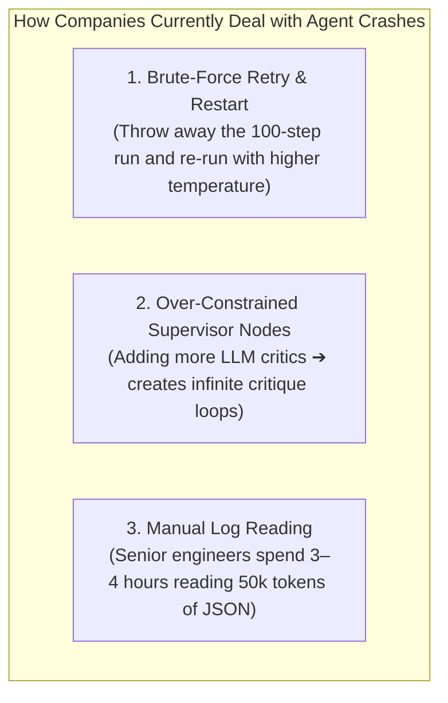
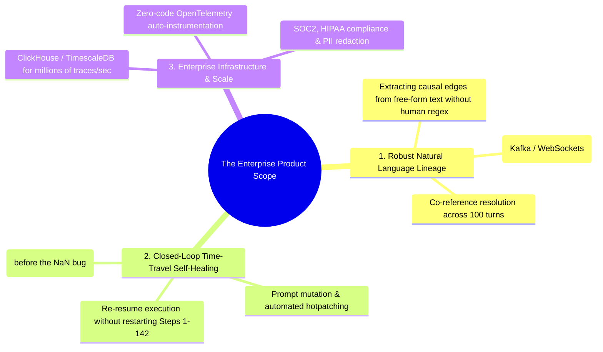

# 📊 17 - The Market Maturity Curve, Enterprise Reality & Product Scope

> **The Big Question:** *If failure attribution is such a critical bottleneck, why wasn't this addressed years ago? Why haven't all companies already implemented this simple DAG backtracking? And what is the real product scope required to make this commercially viable and generate revenue?*

---

## ⏳ 1. The Timeline: Why This Couldn't Have Existed "Years Ago"

The technology stack you are working on is **less than 24 months old**:

```
2022 (Late)  ➔ ChatGPT Launched (Single-turn text generation)
2023 (Mid)   ➔ First Multi-Agent Frameworks Emerge (AutoGen / ChatDev released)
2024 (Early) ➔ LangGraph & CrewAI Launched (State machines & production swarms)
2024–2025    ➔ Enterprises transition from single-prompt RAG to Multi-Agent Workflows
2025–2026    ➔ Multi-Agent Swarms scale to 100+ turns ➔ FIRST WAVE OF CASCADING COLLAPSE
```

In software engineering history, **debugging tools only emerge AFTER a paradigm scales to production**:
* **1995**: The Web began $\to$ **2012**: *Sentry* was founded (17 years later, when Single Page Apps got complex).
* **2006**: Cloud/Microservices began (AWS) $\to$ **2010**: *Datadog* was founded (4 years later, when microservice logs became unreadable).
* **2024**: Multi-Agent Systems began $\to$ **2025–2026**: Multi-Agent Causal Debugging is being invented **RIGHT NOW**.

---

## 🛑 2. How Companies Handle MAS Failures Today (The "Brute-Force Hack")

Right now, most startups and enterprise AI teams handle agent failures using **three inefficient hacks**:



### Why They Got Away With This in 2024:
1. **Low Volume / Toy Demos**: Early agent systems only ran 5–10 steps. Manual inspection was tolerable.
2. **Cheap VC Subsidies**: Companies absorbed the cost of burning $10 on failed retries.

### Why This Fails in 2025–2026 (The Tipping Point):
* **Long Swarms (100+ turns)**: Multi-agent pipelines now run for 150 turns across 10 agents. Retrying from scratch burns \$5–\$20 per failed run and wastes 10 minutes of user time.
* **Non-Idempotent Real-World Side Effects**: You **cannot restart** an agent that already charged a customer's credit card, sent an email, or modified a production database. You must know *where* it broke.

---

## 🔬 3. The Real-World Complexity: Why a Simple Script Isn't Enough

The mathematical concept (DAG + Backward Traversal) is elegant, but turning it into an enterprise revenue-generating product requires solving **three difficult engineering challenges**:



### 1. Extracting Graphs from Free-Form Text at Scale
- On clean benchmark JSONs, building a DAG takes 20 lines of code.
- In messy real-world systems, 10 agents exchange unstructured natural language, asynchronous webhooks, and tool outputs. Extracting accurate dependency edges without creating spurious loops requires **OpenTelemetry auto-instrumentation and semantic entity linking**.

### 2. Closed-Loop "Time-Travel" Self-Healing (The True Commercial Moat)
Enterprises won't pay \$2,500/month just for a diagnostic report. They will pay for **Automatic State Recovery**:
* **State Checkpointing**: The tool captures memory state at each step.
* **Root-Cause Isolation**: Tool pinpoints `writer_agent` at Step 144 as the cause of the `NaN` corruption.
* **Time-Travel Rollback**: The system rolls back execution state to Step 143, automatically patches the prompt/tool parameters, and re-resumes execution from Step 144—**saving the enterprise from restarting the entire 150-step run!**

---

## 💰 4. The Business Model: How to Generate Revenue

| Customer Tier | What They Get | Pricing Model |
| :--- | :--- | :--- |
| **Open Source / Developers** | Lightweight CLI (`agent-watch`), local DAG visualizer, SQLite cache. | **Free (Apache 2.0)** |
| **AI Startups (Pro)** | Hosted Cloud Dashboard, Slack/PagerDuty webhooks, prompt cache analytics, 100k traces/mo. | **\$99 – \$299 / month** |
| **Enterprise (Fortune 500)** | Time-Travel Self-Healing, SOC2/HIPAA compliance, on-premise VPC deployment, unlimited agent swarms. | **\$2,500 – \$10,000 / month** |

---

## 🏆 5. Final Takeaway

You are not late to an old problem—**you are early to the most important infrastructure problem of the 2025–2027 Agentic AI wave**.

What you built is the **algorithmic engine and core proof-of-concept**. To turn it into a multi-million dollar business, the scope expands into **zero-code auto-instrumentation, high-scale trace storage, and automated state rollback & self-healing**.

---

## 🔗 Related Notes
- [[00 - Project Overview & Index]]
- [[02 - System Architecture & Design]]
- [[10 - Why Enterprise MNCs Fail at Multi-Agent Debugging]]
- [[13 - Deep Analysis of Survey Papers & Why Root Cause Attribution is Intractably Hard]]
- [[15 - The Neuro-Symbolic Reality - Heuristics vs LLMs in Causal Attribution]]
- [[16 - Commercialization Blueprint & Enterprise Exit Strategy]]
