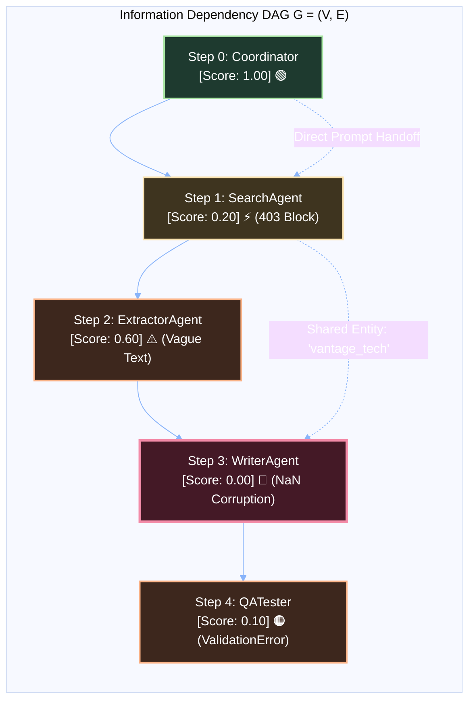
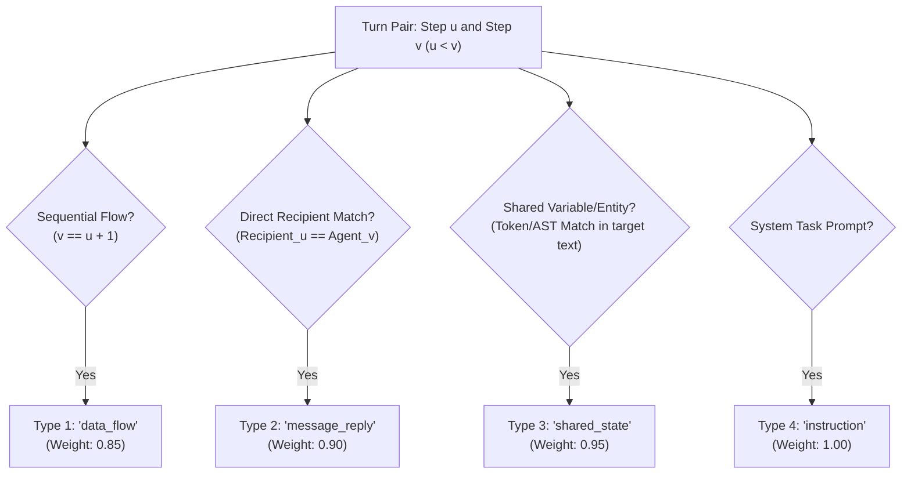

# 🕸️ 18 - Detailed Dependency Graph Architecture & Specifications

This document provides the complete structural, mathematical, and algorithmic specification of the **Information-Dependency Directed Acyclic Graph (DAG)** powering our failure attribution engine.

---

## 📐 1. Mathematical Formalism

The multi-agent execution history is modeled as a **Directed Acyclic Graph (DAG)**:
$$\mathcal{G} = (\mathcal{V}, \mathcal{E})$$



* **Vertices $\mathcal{V}$**: Discrete execution turns $\mathcal{V} = \{s_0, s_1, \dots, s_{N-1}\}$.
* **Directed Edges $\mathcal{E}$**: An edge $(u, v) \in \mathcal{E}$ (where $u < v$) indicates that execution step $v$ causally consumed data, variables, state, or instructions produced by step $u$.
* **Acyclicity Guarantee**: Because execution moves forward in time, $u < v$ holds for all edges, ensuring $\mathcal{G}$ contains **no cycles**.

---

## 🏷️ 2. Node Schema & Data Structure

Each node in the `NetworkX.DiGraph` represents a single turn in the multi-agent dialogue:

```python
# Node Attributes in NetworkX
G.add_node(
    step_index=idx,            # Integer index (0, 1, 2, ... 149)
    step_id=step.step_id,      # Unique ID (e.g., 'step_1', 'step_144')
    agent=step.agent_name,     # Active agent (e.g., 'writer_agent')
    recipient=step.recipient,  # Target agent (e.g., 'analyst_agent')
    action_type=action_type,   # e.g., 'tool_call', 'sql_query', 'message'
    score=evaluation.score,    # Health score [0.0 to 1.0]
    status=diagnostic_status,  # 'root_cause', 'propagated_symptom', 'normal'
    reason=judge_explanation   # Detailed justification from step judge
)
```

### Node Diagnostic Status Taxonomy:
| Status | Color | Visual Meaning |
| :--- | :---: | :--- |
| 🔴 **`root_cause`** | Red (`#f38ba8`) | The earliest invalid step that introduced corrupted state into the workflow. |
| ⚡ **`upstream_trigger`** | Yellow (`#f9e2af`) | An environmental failure (e.g., Cloudflare 403) that forced downstream fragile retries. |
| 🟠 **`propagated_symptom`**| Orange (`#fab387`) | Downstream steps that crashed because they inherited flawed input from upstream. |
| 🟢 **`normal`** | Green (`#a6e3a1`) | Completely healthy execution step. |

---

## 🔗 3. Edge Architecture: The 4 Connection Types

Connections between turns are established via a multi-tiered typed linker in [`core/dependency_linker.py`](file:///d:/Projects/LLM/core/dependency_linker.py):



1. **`data_flow` (Sequential Continuity)**:
   - Automatically connects adjacent turns $(i-1 \to i)$ to maintain conversation dialogue continuity.
2. **`message_reply` (Conversational Handoff)**:
   - Added when step $u$'s `recipient` explicitly equals step $v$'s `agent_name`.
3. **`shared_state` (Long-Range Variable & Entity Lineage)**:
   - Extracts identifier tokens (e.g., `operating_margin`, `users` table, `discount_rate`, `calc_var()`) from step $u$'s payload/output and checks if they appear in step $v$'s input/action.
   - Enables the graph to bridge **non-adjacent turns** (e.g., Step 3 passing a variable to Step 90).
4. **`instruction` (Task Constraint Propagation)**:
   - Links the initial user prompt / coordinator task goal to the agents executing subtasks.

---

## ⚙️ 4. Graph Operations & Traversal Algorithms

We leverage Python's `NetworkX` library to perform high-speed topological and reachability operations:

```python
import networkx as nx

# 1. Extract all upstream causal ancestors leading to the crash
causal_ancestors = nx.ancestors(dag, manifest_failure_step_index)
causal_ancestors.add(manifest_failure_step_index)

# 2. Check parent health
for candidate_step in causal_anomalies:
    parents = list(dag.predecessors(candidate_step))
    anomalous_parents = [p for p in parents if p in anomalous_indices and p < candidate_step]
    if not anomalous_parents:
        root_cause_index = candidate_step
        break

# 3. Compute the exact shortest causal path from Root Cause to Final Crash
causal_chain = nx.shortest_path(dag, source=root_cause_index, target=manifest_failure_step_index)
```

---

## 🖥️ 5. Interactive Visual Graph Rendering (Pyvis & Streamlit)

In [`dashboard/components/dag_viewer.py`](file:///d:/Projects/LLM/dashboard/components/dag_viewer.py), the NetworkX graph is converted into an interactive HTML canvas using `pyvis.network.Network`:

* **Physics-based layout**: Nodes repel each other and settle into a clear, readable tree.
* **Interactive Tooltips**: Hovering over any node displays:
  - Agent Name & Action Type
  - Health Score ($0.0 - 1.0$)
  - Judge Diagnosis Summary
* **Dynamic Highlight**: Clicking on the 🔴 Root Cause node highlights the entire downstream causal error chain in red/orange.

---

## 🔗 Related Notes
- [[00 - Project Overview & Index]]
- [[02 - System Architecture & Design]]
- [[03 - Core Engine Implementation]]
- [[07 - Theoretical Concepts & Core Mechanisms]]
- [[15 - The Neuro-Symbolic Reality - Heuristics vs LLMs in Causal Attribution]]
