# 🎨 19 - Embedding HTML, CSS & Custom Diagrams in Obsidian

Obsidian is built on Chromium and Electron, meaning it has **100% native support for raw HTML5, CSS3, SVG vector graphics, and `<iframe>` embeds**.

If Mermaid diagram text is blending into your dark-mode or light-mode background, you can use these **three superior methods**:

---

## 📑 Table of Contents
1. [[#1. Fixing Mermaid Diagram Text Contrast (The Quick Fix)|1. Fixing Mermaid Diagram Text Contrast (The Quick Fix)]]
2. [[#2. Native HTML & CSS Cards in Obsidian|2. Native HTML & CSS Cards in Obsidian]]
3. [[#3. Pure Inline SVG Vector Diagrams (Zero Text Clashing)|3. Pure Inline SVG Vector Diagrams (Zero Text Clashing)]]
4. [[#4. Embedding Interactive HTML via iframe (Pyvis Physics DAG)|4. Embedding Interactive HTML via iframe (Pyvis Physics DAG)]]

---

# 1. Fixing Mermaid Diagram Text Contrast (The Quick Fix)

### The Cause:
Mermaid's default `color:#000` (black text) or theme variables clash when Obsidian is in Dark Mode, making the letters blend into the dark node fill or dark canvas.

### The Solution:
Add a Mermaid initialization header at the top of the diagram block, or use theme-safe background-to-text contrast colors:

```mermaid
%%{init: {'theme': 'base', 'themeVariables': { 'textColor': '#ffffff', 'lineColor': '#89b4fa', 'primaryTextColor': '#ffffff', 'nodeBorder': '#89b4fa'}}}%%
graph LR
    S0["Step 0: Coordinator<br/>(Initial Goal) 🟢"] --> S1["Step 1: SearchAgent<br/>(403 Forbidden) ⚡"]
    S1 --> S2["Step 2: ExtractorAgent<br/>(Vague Range) ⚠️"]
    S2 --> S3["Step 3: WriterAgent<br/>(Reset to NaN) 🔴"]
    S3 --> S4["Step 4: QATester<br/>(ValidationError) 🟠"]

    style S0 fill:#1e3a2f,stroke:#a6e3a1,stroke-width:2px,color:#ffffff
    style S1 fill:#3e341f,stroke:#f9e2af,stroke-width:2px,color:#ffffff
    style S2 fill:#3d271d,stroke:#fab387,stroke-width:2px,color:#ffffff
    style S3 fill:#441926,stroke:#f38ba8,stroke-width:3px,color:#ffffff
    style S4 fill:#3d271d,stroke:#fab387,stroke-width:2px,color:#ffffff
```



---

# 2. Native HTML & CSS Cards in Obsidian

You can write raw HTML directly in any Obsidian note! Here is a high-contrast failure attribution card:

<div style="background-color: #1e1e2e; border: 2px solid #f38ba8; border-radius: 12px; padding: 18px; margin: 16px 0; color: #cdd6f4; font-family: -apple-system, BlinkMacSystemFont, 'Segoe UI', Roboto, sans-serif;">
  <div style="display: flex; justify-content: space-between; align-items: center; border-bottom: 1px solid #313244; padding-bottom: 10px; margin-bottom: 12px;">
    <span style="font-size: 1.1em; font-weight: bold; color: #f38ba8;">🚨 ROOT CAUSE DETECTED: Step 144</span>
    <span style="background-color: #f38ba8; color: #11111b; font-weight: bold; padding: 3px 10px; border-radius: 20px; font-size: 0.85em;">writer_agent</span>
  </div>
  <p style="margin: 6px 0; font-size: 0.95em; color: #cdd6f4;">
    <strong>Decisive Action:</strong> While executing math correction on segment sums, the state tree was corrupted, resetting <code>operating_margin</code> to <code>NaN</code>.
  </p>
  <div style="background-color: #181825; border-left: 4px solid #fab387; padding: 10px 14px; margin-top: 10px; border-radius: 4px; font-family: monospace; font-size: 0.9em; color: #fab387;">
    ValidationError: 'operating_margin' in companies['vantage'] was reset to NaN during step 144 table patch.
  </div>
</div>

---

# 3. Pure Inline SVG Vector Diagrams (Zero Text Clashing)

Because Obsidian supports inline SVG, you can draw diagrams where text color, box fill, and arrow strokes are **100% fixed and immune to theme inversions**:

<svg width="100%" height="150" viewBox="0 0 780 140" xmlns="http://www.w3.org/2000/svg" style="background: #181825; border-radius: 10px; border: 1px solid #313244; margin: 15px 0;">
  <!-- Step 19: Search Trigger -->
  <rect x="20" y="30" width="160" height="80" rx="8" fill="#3e341f" stroke="#f9e2af" stroke-width="2"/>
  <text x="100" y="55" fill="#f9e2af" font-size="13" font-weight="bold" text-anchor="middle" font-family="sans-serif">Step 19: SearchAgent</text>
  <text x="100" y="75" fill="#ffffff" font-size="11" text-anchor="middle" font-family="sans-serif">HTTP 403 Forbidden</text>
  <text x="100" y="93" fill="#f9e2af" font-size="10" font-weight="bold" text-anchor="middle" font-family="sans-serif">⚡ UPSTREAM TRIGGER</text>

  <!-- Arrow 1 -->
  <line x1="180" y1="70" x2="220" y2="70" stroke="#89b4fa" stroke-width="2" marker-end="url(#arrow)"/>
  <polygon points="220,70 212,65 212,75" fill="#89b4fa"/>

  <!-- Step 144: Root Cause Bug -->
  <rect x="230" y="25" width="170" height="90" rx="8" fill="#441926" stroke="#f38ba8" stroke-width="3"/>
  <text x="315" y="52" fill="#f38ba8" font-size="14" font-weight="bold" text-anchor="middle" font-family="sans-serif">Step 144: WriterAgent</text>
  <text x="315" y="72" fill="#ffffff" font-size="11" text-anchor="middle" font-family="sans-serif">Reset Margin to NaN</text>
  <text x="315" y="92" fill="#f38ba8" font-size="11" font-weight="bold" text-anchor="middle" font-family="sans-serif">🔴 PRIMARY ROOT CAUSE</text>

  <!-- Arrow 2 -->
  <line x1="400" y1="70" x2="440" y2="70" stroke="#89b4fa" stroke-width="2"/>
  <polygon points="440,70 432,65 432,75" fill="#89b4fa"/>

  <!-- Step 149: Secondary Failure -->
  <rect x="450" y="30" width="150" height="80" rx="8" fill="#3d271d" stroke="#fab387" stroke-width="2"/>
  <text x="525" y="55" fill="#fab387" font-size="13" font-weight="bold" text-anchor="middle" font-family="sans-serif">Step 149: Supervisor</text>
  <text x="525" y="75" fill="#ffffff" font-size="11" text-anchor="middle" font-family="sans-serif">Context Saturation</text>
  <text x="525" y="93" fill="#fab387" font-size="10" font-weight="bold" text-anchor="middle" font-family="sans-serif">⚠️ RECOVERY FAIL</text>

  <!-- Arrow 3 -->
  <line x1="600" y1="70" x2="640" y2="70" stroke="#89b4fa" stroke-width="2"/>
  <polygon points="640,70 632,65 632,75" fill="#89b4fa"/>

  <!-- Step 150: Terminal Crash -->
  <rect x="650" y="30" width="110" height="80" rx="8" fill="#2d1b2d" stroke="#cba6f7" stroke-width="2"/>
  <text x="705" y="55" fill="#cba6f7" font-size="13" font-weight="bold" text-anchor="middle" font-family="sans-serif">Step 150</text>
  <text x="705" y="75" fill="#ffffff" font-size="11" text-anchor="middle" font-family="sans-serif">Abort Execution</text>
  <text x="705" y="93" fill="#cba6f7" font-size="10" font-weight="bold" text-anchor="middle" font-family="sans-serif">💀 TERMINAL</text>
</svg>

---

# 4. Embedding Interactive HTML via `<iframe>` (Pyvis Physics DAG)

Obsidian can render full interactive HTML files! When you run the Streamlit dashboard or export a Pyvis graph to `dag_visualizer.html`, you can embed it inside Obsidian:

```html
<iframe 
  src="file:///d:/Projects/LLM/dashboard/dag_visualizer.html" 
  width="100%" 
  height="500px" 
  style="border: 1px solid #313244; border-radius: 10px;">
</iframe>
```

This allows you to drag nodes, zoom in, and click around the interactive physics graph directly inside your Obsidian notes!

---

## 🔗 Related Notes
- [[00 - Project Overview & Index]]
- [[07 - Theoretical Concepts & Core Mechanisms]]
- [[18 - Detailed Dependency Graph Architecture & Specifications]]
