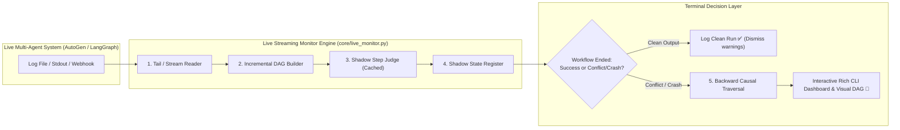

# Real-Time Streaming Log Watcher & Live Failure Attribution CLI (`agent-watch`)

## Problem & Concept Overview

When developers run multi-agent frameworks (AutoGen, CrewAI, LangGraph, MetaGPT), logs are streamed continuously to files, standard output, or webhooks. 

Current observability tools suffer from two extremes:
1. **Overly Aggressive Alerting**: Interrupting or spamming warnings every time an agent encounters a temporary warning (e.g., a single HTTP 403 or retry), even when the agent self-corrects downstream.
2. **Post-Mortem Latency**: Waiting until the entire workflow finishes and manually dumping logs into an offline inspector.

### Proposed Solution: Live Incremental DAG & Shadow Monitoring
We will create a lightweight, real-time **Streaming Log Watcher & Live Attribution CLI (`agent-watch`)** that:
1. **Streams Multi-Agent Logs in Real-Time**: Tails log files (`tail -f`), reads JSONL streams from `stdin`, or listens on a local webhook server.
2. **Constructs the Information DAG Incrementally**: Dynamically builds nodes and dependency edges on-the-fly as turns occur.
3. **Shadow Anomaly Scoring**: Evaluates and caches step health in shadow memory **without stopping execution or spamming premature alerts**.
4. **Terminal Conflict-Triggered Root-Cause Attribution**:
   - If the multi-agent system completes and satisfies the expected output/goal $\to$ Silently marks execution as SUCCESS (intermediate recovered warnings are discarded).
   - If execution crashes, aborts, or the final output conflicts with expected goal $\to$ Immediately executes **Backward Causal Traversal** on the incrementally built DAG and prints an interactive Rich terminal report + saves a visual HTML graph!

---

## User Review Required

> [!IMPORTANT]
> **Key Architectural Decision: Shadow Monitoring vs. Live Interruption**
> The system is intentionally designed in **Shadow Monitoring Mode**: it tracks potential errors in the background as the agent runs, but **only triggers failure attribution if the execution terminates in error or conflicts with the expected outcome**. This avoids false alarms on recovered retries.

---

## Proposed Changes

---

### Component 1: Incremental Live Monitoring Engine (`core/live_monitor.py`)

#### [NEW] `core/live_monitor.py`
- Implements `LiveTraceMonitor`:
  - `start_session(trace_id, task_goal, expected_output=None)`
  - `ingest_step_live(step_payload)`: Incrementally adds node to `NetworkX.DiGraph`, updates dynamic dependency edges with prior active turns, and evaluates step health in the background using `step_judge`.
  - `evaluate_terminal_state(final_output, status)`: Checks if final output matches `expected_output` or if status is `FAILED`. If a conflict occurs, automatically triggers backward traversal from the conflict node to isolate the root cause.

---

### Component 2: Streaming Log Parsers & Watchers (`cli/log_watcher.py`)

#### [NEW] `cli/log_watcher.py`
- Supports 3 real-time ingestion streams:
  1. **File Tail Watcher**: Follows growing log files (`watch_file(path)`).
  2. **Standard Input Stream**: Pipes live stdout (`python run_agents.py | python -m cli.main`).
  3. **Local Webhook Receiver**: Lightweight HTTP receiver (`/webhook/log`) for frameworks with callback handlers.
- Auto-detects log formats: AutoGen dialogue lines (`[AgentA -> AgentB]: ...`), LangGraph state event JSONs, and standard JSONL lines.

---

### Component 3: Rich Terminal Live Dashboard (`cli/main.py`)

#### [NEW] `cli/main.py`
- Interactive command-line interface using `rich.live.Live`, `rich.table.Table`, and `rich.tree.Tree`:
  - `python -m cli.main watch --log-file agents.log --goal "Market report" --expect "revenue"`
  - `python -m cli.main stream --goal "DB Migration"`
- Live UI features:
  - Real-time turn counter & active agent banner.
  - Streaming dependency DAG tree view in terminal.
  - On terminal failure: Displays color-coded Root Cause box (🔴 Red = Bug, ⚡ Yellow = Trigger, 🟠 Orange = Cascading Symptoms).

---

### Component 4: Integration with Web Dashboard & REST API

#### [MODIFY] [api/routes.py](file:///d:/Projects/LLM/api/routes.py)
- Add `/api/v1/live/start`, `/api/v1/live/ingest`, and `/api/v1/live/end` endpoints to support streaming from cloud or remote agents.

---

## Verification Plan

### Automated Tests
1. **Live Incremental Ingestion Test**:
   - `pytest tests/test_live_monitor.py -v`:
     - Test streaming 10 sequential turns one-by-one.
     - Verify DAG grows dynamically on each step.
     - Verify shadow anomaly register tracks errors silently without early termination.
     - Test successful execution (warnings dismissed, 0 false alarms).
     - Test conflict execution (final schema conflict triggers backward traversal and isolates Step 2).

2. **Full Test Suite Integrity**:
   - Run `python -m pytest` to verify all 12 existing tests continue to pass.

### Manual Verification
1. **Streaming Log Test**:
   - Run a simulated streaming script that appends turns into a mock log file `test_run.log` with delays.
   - Run `python -m cli.main watch --log-file test_run.log --goal "Competitive Intelligence"`.
   - Verify the Rich terminal shows streaming updates in real-time and renders the root-cause diagnosis upon completion.
